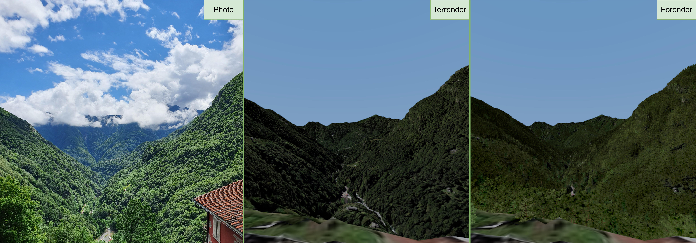

Forender is a web-based, real-time renderer for Swiss forests that displays up to 18 million trees in the browser. Existing web visualizers typically cannot show forests at long viewing distances, and their visual fidelity is often low even up close. Forender targets both problems.

I developed Forender as my master thesis at [VMML Lab](https://www.ifi.uzh.ch/en/vmml.html) (UZH) and [GTC](https://gtc.inf.ethz.ch/) (ETHZ).

## Showcase

  

  
  Left to right: real photo, Terrender (terrain only, no trees), and Forender.
  Terrender is the terrain renderer Forender builds on, so the comparison shows what the trees add.

  
  Image showcasing large viewing distance

Terrender is the terrain renderer Forender builds on, so the comparison shows what the trees add to the scene.

<video width=100% controls>
    <source src="teaser1.mp4" type="video/mp4">
    Your browser does not support the video tag.
</video>

<video width=100% controls>
    <source src="teaser2.mp4" type="video/mp4">
    Your browser does not support the video tag.
</video>

## Key contributions

- **Offline data pipeline.** Extracts tree information from public geographic data. Beyond position and height, it derives per-tree species and averaged leaf color, enabling a more accurate appearance.
- **Established real-time techniques, adapted to the Web.** Web-based forest visualizers rarely apply techniques such as frustum culling and discrete LODs consistently. Forender integrates them and adds multiple density levels, which gradually reduce the number of trees at a distance. Both the WebGL and WebGPU versions use a quadtree for asynchronous data streaming and hierarchical culling.
- **GPU-driven rendering with WebGPU.** To overcome WebGL's performance and appearance limitations, the WebGPU version performs per-instance culling, density reduction, and LOD selection on the GPU. To my knowledge, this is one of the first applications of GPU-driven rendering to large-scale forest visualization on the Web.
- **Performance and visual quality evaluation.** Tested on scenes with up to 18 million extracted trees, using multiple trajectories to stress different viewing conditions. Interactive frame times hold across all scenes, with a mean of at most 20 ms and a 99th percentile of at most 32 ms.

## Evaluation
### Setup
 
All experiments ran on a single laptop, with both the frontend and the backend on the same machine.
 
| Component | Details |
|---|---|
| OS | Windows 11 (10.0.26200) |
| CPU | Intel Core i7-11800H |
| GPU | NVIDIA GeForce RTX 3060 Laptop GPU, 6 GB VRAM (driver 32.0.15.9282) |
| RAM | 16 GB DDR4 |
| Browser | Chrome 150.0.7871.187 (V8 15.1.206.16), V-Sync enabled |
| Forender WebGL | TypeScript, compiled with `tsc` 5.9.3 targeting ESNext |
| Forender WebGPU | Rust, compiled with `rustc` 1.94.1 (`opt-level=3`) to WASM modules |

The implementation was evaluated on two scenes in Switzerland as shown below. The Valais scene (green) covers a region of 16 x 17 km and contains 667’996
extracted trees. The Ticino scene (blue) covers 85 x 65 km and contains 17’962’967 trees.

  
  The two evaluated scenes: Valais (green) and Ticino (blue).

Each scene was evaluated along two camera trajectories:
 
- **Near:** flying low over the ground. Fewer trees are visible, but at high detail.
- **Far:** flying high above the ground. Many more trees are visible, each at lower detail.

### Results

With all optimizations enabled (discrete LOD, frustum culling, and occlusion culling, all executed on the GPU), Forender WebGPU stays interactive across every scene and trajectory. Even on the most difficult trajectory, Forender WebGPU achieves:

- **Mean frame time: 20.4 ms** (about 49 FPS)
- **99th percentile: 32.6 ms** (about 30 FPS), so nearly all frames stay within a 30 FPS budget

  
  Ablation on the optimizations implemented in Forender

The general implementation is similar between both graphics APIs. The key difference is granularity: WebGL culls and selects LODs per quadtree leaf node, while WebGPU makes these decisions per instance on the GPU. This brings a notable improvement, especially in worst-case frame times, and lets WebGPU scale to the largest scene.

  
  Frame times of Forender WebGL vs WebGPU

## Thesis

 
Abstract

Forest visualization is important for tasks such as urban planning, forestry, or hike planning. However, visualizing forests at large viewing distances remains challenging due to the visual complexity and large numbers of trees, especially for web applications. Existing web-based visualizers often struggle with interactive frame rates without reducing visual quality. This thesis introduces Forender, a web-based forest visualizer designed to maintain interactive frame rates and visual quality at large viewing distances. Forender is implemented in two graphics APIs, WebGL and WebGPU. Both implementations use a quadtree for asynchronous streaming of forest data and for hierarchical culling. Forender WebGPU uses GPU-driven rendering to perform additional per-instance culling, density reduction, and LOD selection. The finer granularity can reduce unnecessary GPU work compared to Forender WebGL's coarser per-leaf-node operations. Forender WebGL achieves interactive performance in smaller scenes, however it scales poorly to large scenes. In contrast, Forender WebGPU scales efficiently to larger scenes containing up to 18 million trees, while supporting additional visual features such as multiple tree species, leaf tinting, and screen-space ambient occlusion. These results demonstrate that GPU-driven rendering, enabled by the capabilities provided by WebGPU, is a practical and efficient approach for scaling web-based forest visualization to large scenes and viewing distances.

[Read the full thesis here (pdf)](/portfolio_hugo/Forender.pdf)